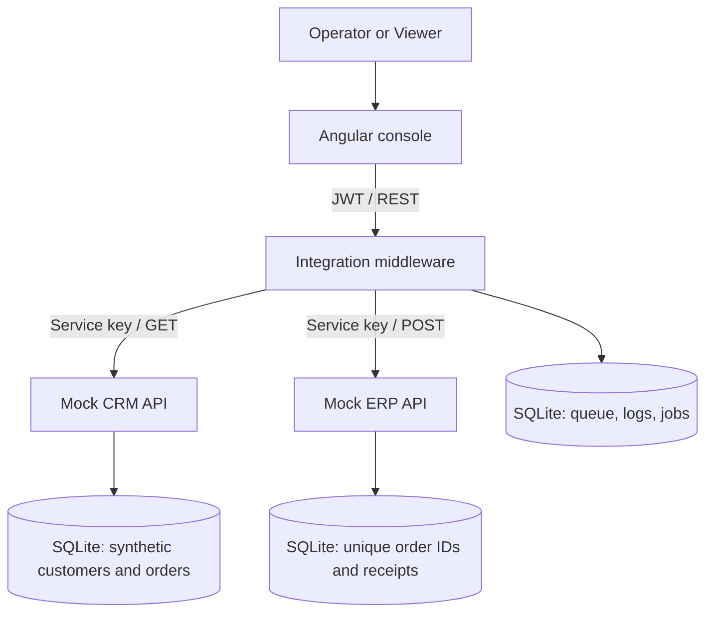
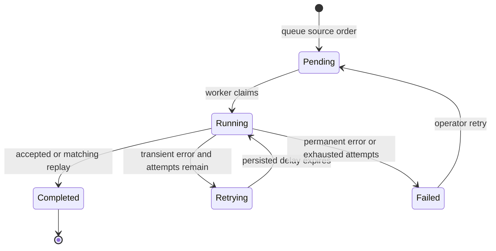

# Architecture

## Context

The portfolio uses three separate ASP.NET Core processes and a standalone Angular client. Every source record is fictional. No proprietary integration or workload platform is connected.

The browser uses a same-origin proxy. It never receives the internal service key. OpenAPI and health endpoints are available for local inspection; all business endpoints require JWT or the service key.

## Code boundaries

| Layer | Responsibility |
|---|---|
| Shared contracts | CRM/ERP DTOs, deterministic mapping, validation, secure demo hosting |
| Hub Domain | Durable execution and log records, synthetic job history |
| Hub Application | IntegrationRunner, failure policy, bounded retry delays |
| Hub Infrastructure | SQLite DbContext, single-replica background worker |
| Hub API | Input validation, JWT roles, queue submission, filtering and metrics |
| Angular | Session held in memory, operations UI, polling and investigation |

The middleware is a modular application with layer folders. It is not presented as a microservice orchestration framework or a fully dependency-inverted enterprise template.

## Execution lifecycle

Submission inserts one execution and its initial log into SQLite, returning HTTP 202. The background worker polls eligible Pending/Retrying rows. An atomic conditional database update claims the row. Request disconnection does not cancel the job.

Every attempt fetches the source order, validates the source identity, maps a payload, and sends it to the ERP. Logs are persisted after each stage. A frozen mapped payload is reused for later retries, including after a crash, so a changed CRM amount cannot silently become a new transaction under the same order ID.

Only 408, 429, 5xx, connection failures and timeouts are eligible for automatic retries. There are at most three attempts per cycle. Delays are 1s then 2s for the normal three-attempt cycle; Retry-After can extend those delays to at most 30s. Permanent validation, authorization, missing-resource and duplicate-conflict failures require investigation.

Manual retry is an atomic Failed → Pending update with an audit log in the same transaction. It clears the selected error simulation, resets the current attempt count, increments RetryCount, and preserves order ID, execution ID, payload and earlier logs. It cannot retry an active or completed execution.

## Delivery guarantees and failure boundaries

- Middleware has a unique index on OrderId. Concurrent inserts cannot create multiple execution identities for the same order.
- ERP stores a unique ExternalOrderId with a SHA-256 fingerprint of the typed JSON payload.
- Repeating an identical payload returns the original receipt with Duplicate=true.
- Reusing the key with changed data returns HTTP 409.
- If ERP commits but the response is lost, replay reconciles against the persistent record.
- This is **at-least-once delivery with idempotent acceptance**, not a claim of distributed exactly-once processing.
- A crash between a logged stage and the next stage can replay work. Startup moves Running rows to Retrying; the ERP guard protects acceptance.
- Recovery assumes **one middleware replica**. Starting multiple replicas against the same file can invalidate startup recovery assumptions; distributed leases are intentionally out of scope.
- Recovery from abrupt termination may produce an extra attempt beyond the normal cycle cap if the previous process died before recording an outcome.
- Unexpected internal worker errors are classified as Internal and require operator investigation.

## Data and observability

Execution timestamps are UTC. The UI formats them in the browser's local timezone. Duration covers the current execution cycle, including automatic retry waits. A manual retry starts a new cycle; historical stage timestamps remain available.

Success rate = Completed / all executions, including in-flight rows. Average duration uses finished cycles with a recorded duration. Status chart and KPI metrics are global; search/status/environment filters apply to the execution table, and environment filtering also applies to the workload table.

Logs carry execution ID, stage, attempt and status. Persisted messages are controlled strings. Raw upstream bodies, authorization headers, credentials and exception messages are deliberately excluded from logs. Mapped payloads contain synthetic order data and are visible only to authenticated users.

## Storage evolution

Separate SQLite databases give each API ownership of its state. Fresh schema creation is appropriate for this disposable demo. A production evolution would introduce versioned EF migrations, durable message transport/outbox coordination, distributed worker leases, retention policies, centralized identity and operational dashboards. Those capabilities are not claimed by this MVP.
