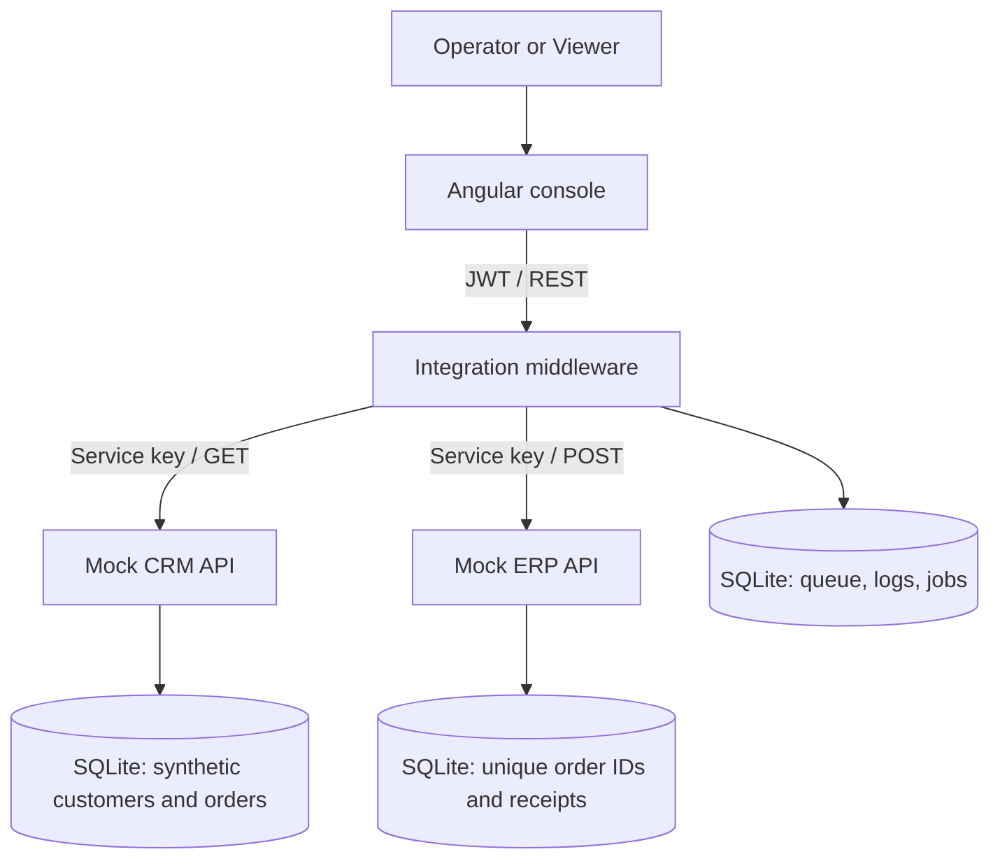
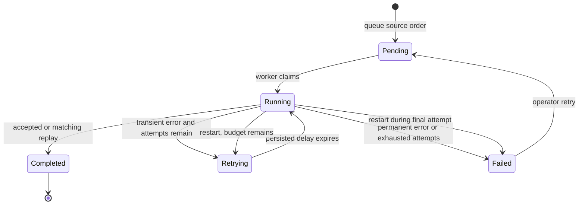
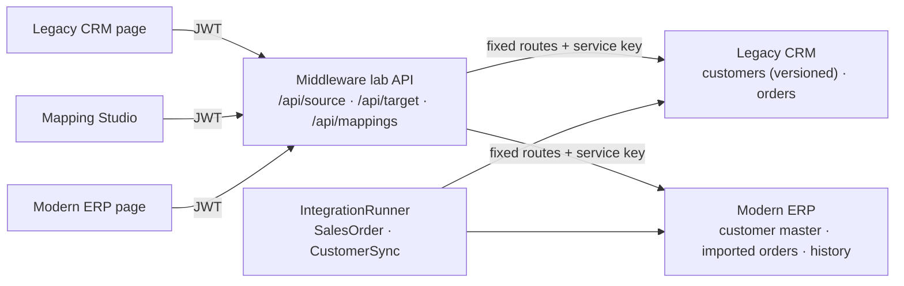

# Architecture

## Context

The portfolio uses three separate ASP.NET Core processes and a standalone Angular client. Every source record is fictional. No proprietary integration or workload platform is connected.

The browser uses a same-origin proxy. It never receives the internal service key. OpenAPI and health endpoints are available for local inspection; all business endpoints require JWT or the service key.

## Code boundaries

| Layer | Responsibility |
|---|---|
| Shared contracts | CRM/ERP DTOs, deterministic mapping, validation, secure demo hosting |
| Hub Domain | Durable execution and log records, synthetic job history |
| Hub Application | IntegrationRunner, failure policy, bounded retry delays |
| Hub Infrastructure | SQLite DbContext, single-replica background worker |
| Hub API | Input validation, JWT roles, queue submission, filtering and metrics |
| Angular | Session held in memory, operations UI, polling and investigation |

The middleware is a modular application with layer folders. It is not presented as a microservice orchestration framework or a fully dependency-inverted enterprise template.

## Execution lifecycle

Submission inserts one execution and its initial log into SQLite, returning HTTP 202. The background worker polls eligible Pending/Retrying rows. An atomic conditional database update claims the row. Request disconnection does not cancel the job.

Every attempt fetches the source order, validates the source identity, maps a payload, and sends it to the ERP. Logs are persisted after each stage. A frozen mapped payload is reused for later retries, including after a crash, so a changed CRM amount cannot silently become a new transaction under the same order ID.

Only 408, 429, 5xx, connection failures and timeouts are eligible for automatic retries. There are at most three attempts per cycle. Delays are 1s then 2s for the normal three-attempt cycle; Retry-After can extend those delays to at most 30s. Permanent validation, authorization, missing-resource and duplicate-conflict failures require investigation.

Manual retry is an atomic Failed → Pending update with an audit log in the same transaction. It clears the selected error simulation, resets the current attempt count, increments RetryCount, and preserves order ID, execution ID, payload and earlier logs. It cannot retry an active or completed execution.

## Delivery guarantees and failure boundaries

- Middleware has a unique index on OrderId. Concurrent inserts cannot create multiple execution identities for the same order.
- ERP stores a unique ExternalOrderId with a SHA-256 fingerprint of the typed JSON payload.
- Repeating an identical payload returns the original receipt with Duplicate=true.
- Reusing the key with changed data returns HTTP 409.
- If ERP commits but the response is lost, replay reconciles against the persistent record.
- This is **at-least-once delivery with idempotent acceptance**, not a claim of distributed exactly-once processing.
- A crash between a logged stage and the next stage can replay work; the ERP guard protects acceptance.
- The attempt number is persisted (with a `Started` log) before any upstream call, so an interrupted attempt is counted. On startup, each Running row is resolved by `ExecutionRecovery`:
  - attempts remaining → `Retrying` immediately, audited as `RecoveryScheduled`;
  - final attempt interrupted → `Failed` with class `Interrupted`, audited as `RecoveryExhausted`. A manual retry is then required.
  Repeated crashes therefore cannot exceed three automatic attempts per cycle. The runner also refuses to start an attempt beyond the budget (`RetryExhausted`), as a second safeguard.
- Recovery assumes **one middleware replica**. Starting multiple replicas against the same file can invalidate startup recovery assumptions; distributed leases are intentionally out of scope.
- Unexpected internal worker errors mark the execution `Failed` with class `Internal`, record duration and an audit entry, and require operator investigation. Nothing is left in Running unless the process itself stops, in which case startup recovery resolves it.

## Audit trail

Each lifecycle decision writes an `ExecutionLog` row in the same `SaveChanges` call (or transaction) as the state change, so the timeline never disagrees with the stored status. Entries carry a UTC timestamp, execution ID, attempt number and level.

| Stage | When | Level |
|---|---|---|
| Queued | Execution created; names the actor (`operator (Operator)`), environment, simulation and budget | Information |
| Started | Attempt *n* of 3 begins | Information |
| Retrieved / Mapped | Source fetched; payload validated and frozen | Information |
| Completed | ERP accepted, or confirmed an existing matching receipt | Information |
| RetryScheduled | Transient failure with budget remaining; shows class, next attempt and delay | Warning |
| RetryExhausted | Transient failure on the final attempt, or an attempt refused beyond budget | Error |
| Failed | Permanent failure (not retried automatically), or unexpected Internal error | Error |
| ManualRetry | Operator retry; names the actor, previous class and attempt, and the new cycle | Information |
| RecoveryScheduled / RecoveryExhausted | Startup crash-recovery decision | Warning / Error |

Messages are fixed templates. Tokens, service keys, headers, raw upstream bodies and exception messages are never written. Actor names are the fixed demo account names. The log schema is unchanged, so existing demo databases keep working.

## Dashboard data loading

The console polls every 2.5 seconds. Metrics, execution history, CRM source orders, workloads and the open execution's details are separate requests with **isolated failure handling**:

- A failed section keeps its last good data and appears in a non-blocking *Some data could not be refreshed* notice with its last update time. Other sections keep updating. A CRM outage therefore never hides the execution history needed to investigate it.
- Each section has a request sequence number. Only the newest response is applied, so a slow, older response cannot overwrite a newer filtered result.
- Polling is skipped while requests are in flight. User actions such as filters, paging and Refresh always issue a request.
- Search text is applied on submit. Status and environment filters apply immediately and reset to page 1. An emptied page moves to the last valid page.
- Sign-out (or a 401, or reaching the token's `expiresAt`) aborts in-flight requests, increments a session generation that invalidates late responses, and clears all protected data and filters.

## Data and observability

Execution timestamps are UTC. The UI formats them in the browser's local timezone. Duration covers the current execution cycle, including automatic retry waits. A manual retry starts a new cycle; historical stage timestamps remain available.

Success rate = Completed / all executions, including in-flight rows. Average duration uses finished cycles with a recorded duration. Status chart and KPI metrics are global; search/status/environment filters apply to the execution table. The workload table has its own environment filter.

Logs carry execution ID, stage, attempt and status. Persisted messages are controlled strings. Raw upstream bodies, authorization headers, credentials and exception messages are deliberately excluded from logs. Mapped payloads contain synthetic order data and are visible only to authenticated users.

## Storage evolution

Separate SQLite databases give each API ownership of its state. Fresh schema creation is appropriate for this disposable demo. A production evolution would introduce versioned EF migrations, durable message transport/outbox coordination, distributed worker leases, retention policies, centralized identity and operational dashboards. Those capabilities are not claimed by this MVP.

## Portfolio lab (v2)

### Two integration styles, two policies
| | SalesOrder (SCN-002) | CustomerSync (SCN-001/003) |
|---|---|---|
| Data | Immutable transaction | Mutable master data |
| Middleware key | `OrderId` unique: one execution per order, ever | Each sync is a new execution; partial unique index `IX_Executions_ActiveCustomerSync` allows one active sync per customer |
| Frozen on first mapping | Mapped payload | Mapped payload **and** source version |
| ERP key and rule | `externalOrderId` + fingerprint: replay or 409 | `accountCode` upsert: Created / Updated / Unchanged / SkippedStale (older versions never overwrite newer) |
| Target business rules | Account must exist and be ACTIVE (422) | Required fields, status enum |

The mapping rules live once in `Integration.Shared.Mapping` / `MappingCatalog`. Executions, the preview endpoint and the ERP reconciliation view all use them, so the Mapping Studio can never drift from runtime behaviour.

### Schema evolution without data loss
All three services still call `EnsureCreated` for a fresh database, then run an **additive, idempotent** upgrade (`SchemaUpgrade`):
- `ALTER TABLE … ADD COLUMN` for new nullable or defaulted columns (detected with `PRAGMA table_info`);
- `CREATE TABLE/INDEX IF NOT EXISTS` for new tables (`CustomerRevisions`, `ErpCustomers`, `CustomerHistory`) and the partial index;
- one-time backfills that only fill empty values (v1 execution `SourceId`; contact fields of the two original seed customers);
- seed records inserted only when their ID is missing.

Nothing is dropped, renamed or rewritten. Upgrades are tested against the exact v1 DDL (`SchemaUpgradeTests`) and were applied in place to a live v1 Docker demo stack: every execution, receipt, order and job was preserved, verified row by row against a backup.

The SQLite databases run in **WAL mode**, so recent changes can live in `*.db-wal` files. Back up a service by copying its whole data directory (`docker compose cp crm:/data/. backup/crm/`), not just the `.db` file. This is deliberately not a migration framework; production would use versioned EF Core migrations.

### Target fixtures
C-100/C-200 are seeded in the ERP as `Origin=Fixture` ("migrated at go-live"), so existing order demos work without a prior customer sync. Only fixtures accept manual edits (`FixtureEdit` history with the operator name). The first integration import takes ownership (`Origin=Import`) and is recorded in the history.
