# Enterprise Integration Hub

[](https://github.com/oscaraducal/enterprise-integration-hub/actions/workflows/ci.yml)


**A CRM-to-ERP integration simulator with a monitoring and troubleshooting console.** Built with **C# / ASP.NET Core 10, Entity Framework Core, SQLite and Angular 21**, it shows the parts of enterprise integration that matter after the first successful HTTP call: execution tracking, failure classification, bounded automatic retries, safe manual replay, idempotent delivery, audit trails, and a dashboard that stays useful during an upstream outage.

It is also an **interactive integration lab**. You create or edit fictional records in a *Legacy CRM*, inspect the source-to-target mapping in a **Mapping Studio**, run the integration, and then verify the record the *Modern ERP* actually stored, field by field.

> **Portfolio disclaimer.** This is a personal engineering portfolio project. All systems (Mock CRM, Mock ERP) and all data are fictional. It is **not** an Oracle Integration Cloud, Dell Boomi or ESP dSeries implementation, it does not connect to any vendor platform, and it contains no employer-owned code, credentials, customer data or execution logs. The concepts it demonstrates (execution IDs, stage logs, retries and lower-environment job monitoring) reflect general integration-operations experience.

---

## Contents
[Features](#features) · [Portfolio lab](#portfolio-lab-create-integrate-verify) · [Architecture](#architecture) · [Screenshots](#screenshots) · [Quick start](#quick-start-docker) · [Demo](#demo-in-five-minutes) · [Testing](#testing-and-verification) · [Tech stack](#technology-stack) · [Limitations](#known-mvp-limitations) · [Docs](#documentation)

## Features

**Integration**
- Three independently hosted REST APIs (Mock CRM → Integration Middleware → Mock ERP) with OpenAPI contracts.
- JSON validation and mapping: decimal CRM amounts become integer ERP minor units, and currency and customer references are checked.
- Mapped payloads are frozen on the first valid mapping, so retries can never silently send different data.

**Reliability**
- A durable SQLite execution queue with a single background worker and atomic claims.
- Failure classification (400/401/404/409 are permanent; 408/429/5xx/connection/timeout are transient).
- At most **3 automatic attempts per cycle**, with exponential backoff and bounded `Retry-After` support. The budget also holds across crashes and restarts.
- Idempotent ERP acceptance: an identical replay returns the original receipt, and a changed payload is rejected with 409.

**Monitoring and troubleshooting**
- A unique execution ID per order and an attributed audit timeline (Queued → Started *n of 3* → Retrieved → Mapped → Completed / RetryScheduled / RetryExhausted / Failed / ManualRetry / Recovery*).
- Troubleshooting guidance per error class, and an operator-only **Safely retry** action.
- Search, status and environment filters, plus pagination that stays valid as data changes.
- **Partial-outage tolerance:** if the CRM goes down, history, metrics and investigation keep updating behind a non-blocking warning.
- Synthetic DEV/TEST workload history and failed-job investigation (no real scheduler connection).

**Security and UX**
- JWT authentication with **Operator** (run/retry) and **Viewer** (read-only) roles enforced server-side, plus rate-limited login.
- Generated local credentials only, loopback-only ports and non-root containers.
- Responsive console (mobile, tablet, desktop), light and dark themes, keyboard-accessible tables and 44px touch targets.

## Portfolio lab: create, integrate, verify

| Component | Business meaning | What you can do |
|---|---|---|
| **Legacy CRM** (source system) | An existing business application | Dashboard, searchable customer and sales-order tables, record-detail dialogs with revision history, create/edit forms, a schema catalog (Data Tables) and an API Explorer. No integration controls: imports are initiated by the middleware |
| **Integration Middleware** (integration layer) | My integration work | Retrieve over REST, validate, map, deliver, track execution IDs, retry, prevent duplicates, preview mappings |
| **Modern ERP** (target system) | The receiving application | Dashboard, Customer Master, Sales Orders, Imported Data, Import History, Data Tables and API Explorer; record dialogs show source IDs, import times and execution IDs, and reconcile with the source |

| Scenario | Status | What it demonstrates |
|---|---|---|
| [SCN-001 Customer Master Synchronization](docs/scenarios/SCN-001-customer-master-sync.md) | Implemented | Required-field validation, normalization, create-if-missing, one account per customer |
| [SCN-002 Sales Order Integration](docs/scenarios/SCN-002-sales-order-integration.md) | Implemented | Minor-unit conversion, currency validation, stored mapped orders, idempotency, the customer prerequisite |
| [SCN-003 Customer Update Synchronization](docs/scenarios/SCN-003-customer-update-sync.md) | Implemented | Versioned upsert: changed fields audited with before/after values; older versions never overwrite newer ones |
| [SCN-004 Retail Item Master](docs/scenarios/SCN-004-retail-item-master.md) · [SCN-005 Purchase Order](docs/scenarios/SCN-005-purchase-order.md) | Planned | Documented designs only (fictional merchandising → WMS) |

Each implemented scenario has an in-app **guided walkthrough** with buttons that jump to the right screen and record, a glossary for non-technical viewers, and a [scenario document](docs/scenarios/README.md) covering schemas, mapping tables, sample JSON, endpoints, database changes, errors, retries, reconciliation and tests.

**Mapping Studio.** Source fields are on the left, transformation rules in the centre and target fields on the right. The rules are rendered from the same C# mapping the integration executes. **Preview mapping** shows the input and output JSON and per-field validation errors. It never creates an execution, writes data or calls the ERP.

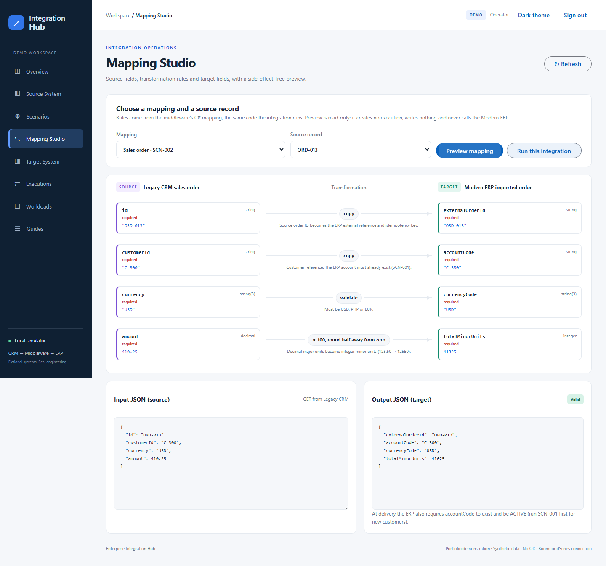

**Reconciliation.** In the Modern ERP, **Compare with source** recomputes the expected value of every field from the live CRM record and compares it with what the ERP stored.

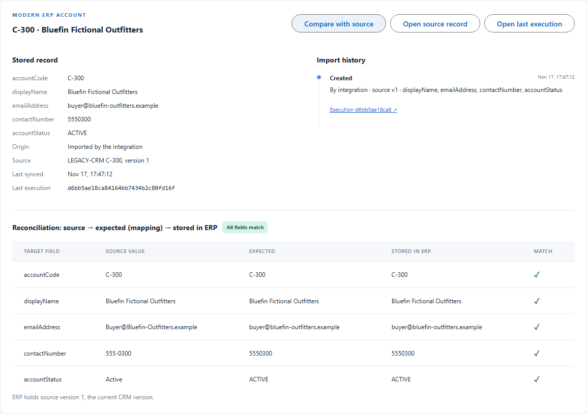

<table>
<tr>
<td width="50%" valign="top">

**A prerequisite, explained:** ORD-610 belongs to a customer the ERP does not know yet. The execution shows *where* it failed (target delivery) and *what to do* (run SCN-001, then **Safely retry**).

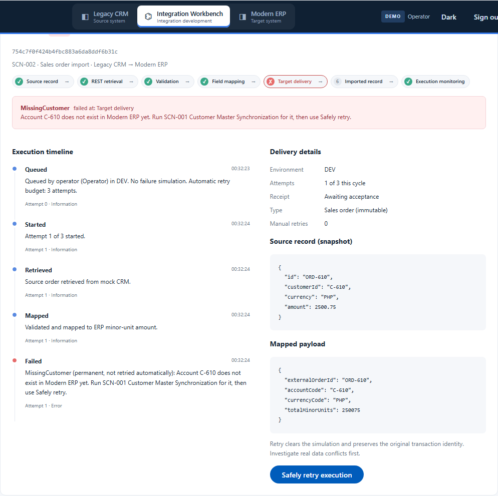
</td>
<td width="50%" valign="top">

**An audited update (SCN-003):** the ERP history shows only the changed fields, before and after, linked to the execution that delivered them.

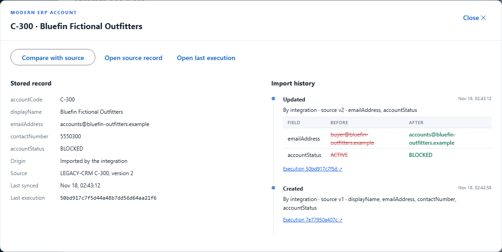
</td>
</tr>
</table>

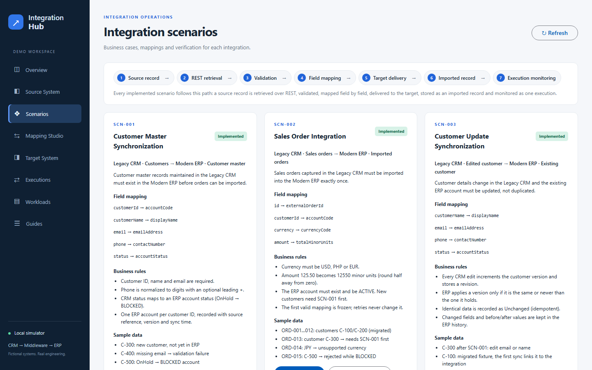

## Architecture

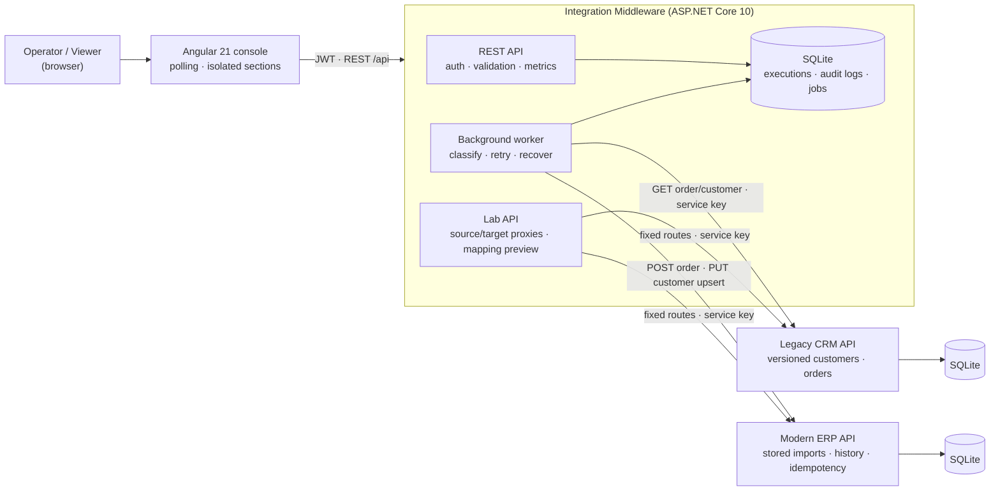

**Data flow:** an operator queues a source order or customer (HTTP 202). The worker claims it, then fetches the order from the CRM, validates it, maps it and freezes the payload, then posts it to the ERP with the execution ID. Every stage is persisted to the timeline. Transient failures are rescheduled with backoff until the 3-attempt budget is spent. Permanent failures stop for investigation. ERP idempotency makes replays safe after lost responses or crashes. This is *at-least-once delivery with idempotent acceptance*, not distributed exactly-once.

Details: [ARCHITECTURE.md](ARCHITECTURE.md) (lifecycle state machine, audit trail, crash recovery, dashboard loading model).

## Screenshots

All screenshots are real: they were captured by the Playwright browser tests against the running Docker Compose stack (Legacy CRM, Middleware and Modern ERP containers) on Windows 11 with Docker Desktop. CI captures the same images on every run. All data is synthetic.

**Integration monitoring dashboard** shows live metrics, status distribution, the CRM → Middleware → ERP route, and the operator-only run form.

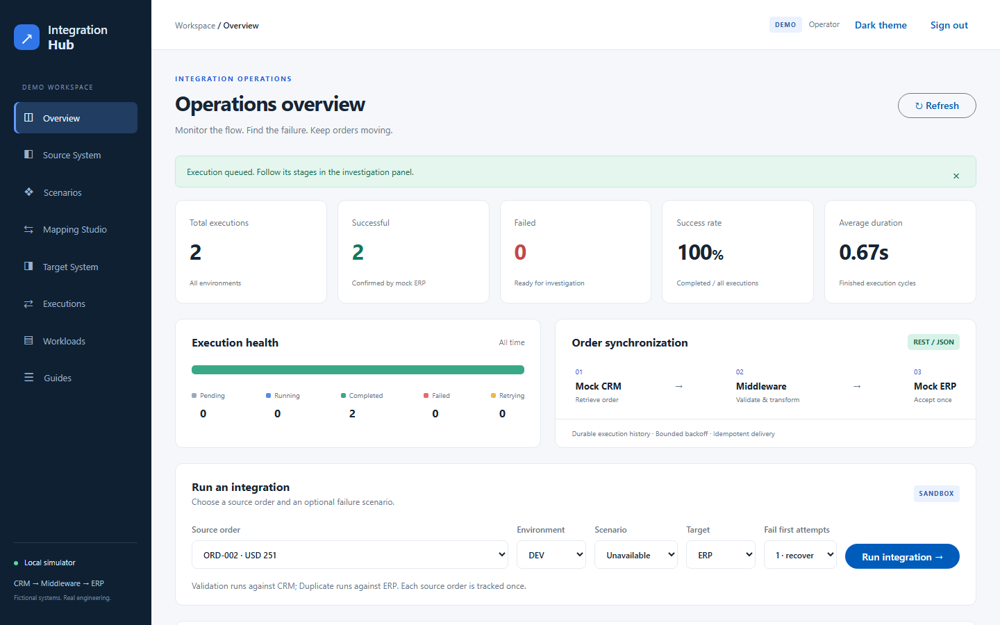

**Execution details and timeline:** ORD-002 hit a simulated ERP 503, was retried automatically (`RetryScheduled`, attempt 2 of 3), and completed. It shows the attributed audit trail, ERP receipt and frozen mapped payload (USD 251.00 → 25100 minor units).

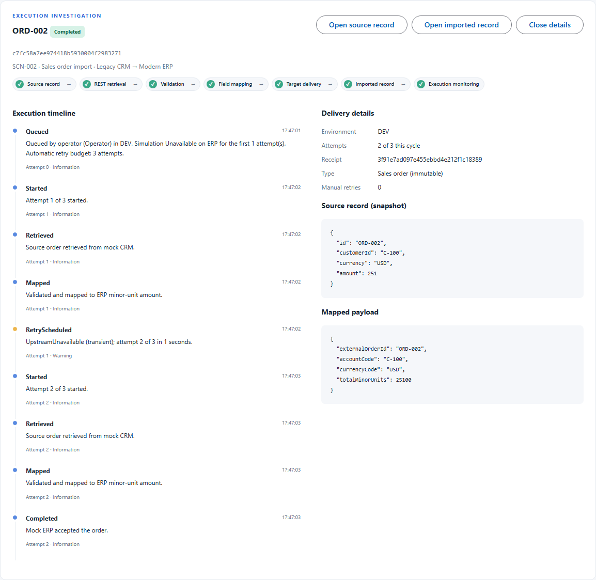

**Failed integration investigation:** ORD-003 was rejected by the ERP with HTTP 400. It's classified `InvalidRequest` (permanent, not retried automatically), with troubleshooting guidance and the operator's **Safely retry execution** action.

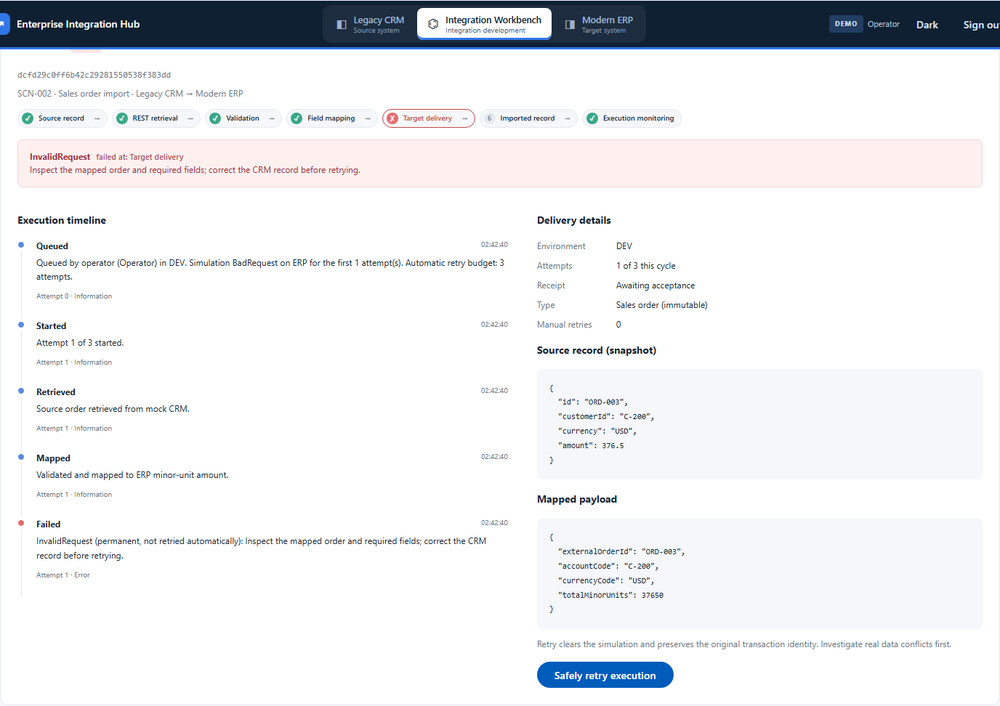

<table>
<tr>
<td width="62%" valign="top">

**Partial CRM outage:** the Mock CRM is unavailable, but metrics and execution history keep updating behind a non-blocking notice that shows when the source orders were last loaded.

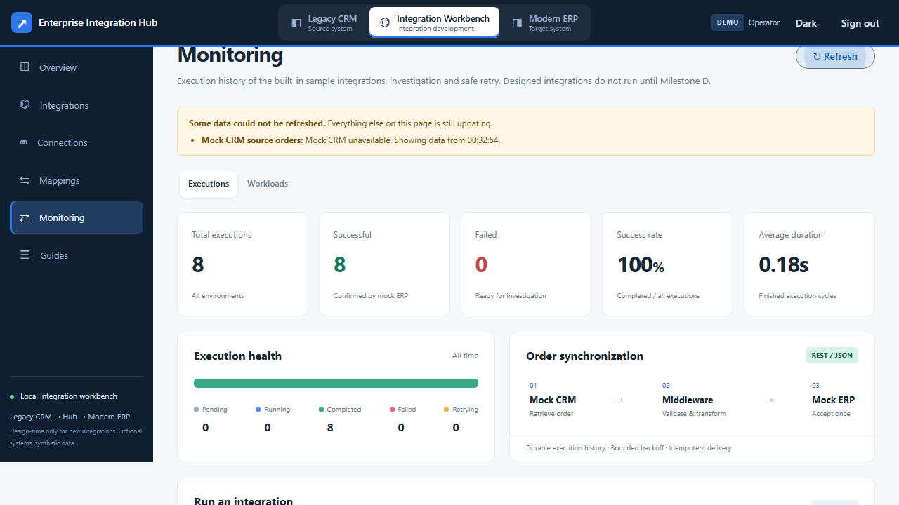
</td>
<td width="38%" valign="top">

**Mobile layout (390 px)**

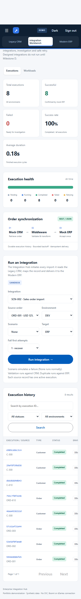
</td>
</tr>
</table>

More captures (tablet, dark theme, mobile investigation) are in the `verification-reports` artifact of each [CI run](https://github.com/oscaraducal/enterprise-integration-hub/actions/workflows/ci.yml).

## Quick start (Docker)

Prerequisites: **Git, Node.js 24, Docker Desktop / Engine with Compose**. Windows 11 users can follow the step-by-step **[Windows 11 checklist](docs/WINDOWS_TESTING.md)**.

```sh
git clone https://github.com/oscaraducal/enterprise-integration-hub.git
cd enterprise-integration-hub
git switch feature/integration-portfolio-lab   # the lab; the earlier MVP is on feature/initial-implementation
node scripts/setup.mjs        # writes random local credentials to the git-ignored .env
docker compose up --build
```

Open **http://localhost:4200** and sign in as **operator** or **viewer** using `DEMO_PASSWORD` from your local `.env`. Never commit or share that file.

- Stop: `docker compose down` (data is kept in named volumes).
- Reset: `docker compose down -v` **permanently deletes all demo data**, and the next start reseeds it.

<details>
<summary>Run without Docker (.NET 10 SDK + Node.js 24)</summary>

```sh
node scripts/setup.mjs
dotnet restore EnterpriseIntegrationHub.slnx
dotnet build EnterpriseIntegrationHub.slnx -c Release --no-restore
node scripts/dev.mjs          # starts CRM :5101, ERP :5102, middleware :5100
```

Second terminal:

```sh
cd frontend
npm ci
npm start                     # http://localhost:4200, proxies /api to :5100
```

| Service | URL | OpenAPI |
|---|---|---|
| Middleware | http://localhost:5100 | /openapi/v1.json |
| Mock CRM | http://localhost:5101 | /openapi/v1.json |
| Mock ERP | http://localhost:5102 | /openapi/v1.json |

The dashboard proxies `/api` to the middleware, and service keys never reach the browser. SQLite files live in the git-ignored `.data/` folder.
</details>

## Demo in five minutes

| # | Do this | What it shows |
|---|---|---|
| 1 | Run **ORD-001**, scenario **None** | Full trace: mapping to minor units, frozen payload, ERP receipt |
| 2 | Run **ORD-002**, **Unavailable**, 1 failure | `RetryScheduled` → automatic recovery |
| 3 | Run **ORD-003**, **BadRequest** | Permanent failure, guidance, then **Safely retry** with an attributed audit entry |
| 4 | Run **ORD-001** again | Duplicate source order rejected |
| 5 | `docker compose stop crm` | Partial-outage notice; history and investigation still live |
| 6 | Sign in as **viewer** | Read-only role enforced by the API, not only hidden in the UI |
| 7 | **Guides → SCN-002**: Mapping Studio for ORD-013, run it, sync C-300, safely retry | A prerequisite failure explained and resolved; reconciliation ✓ |
| 8 | Edit C-300 in the **Legacy CRM**, then sync (SCN-003) | Versioned update with before/after history in the **Modern ERP** |

The full script is in [docs/DEMO.md](docs/DEMO.md).

## Testing and verification

| Suite | What it covers | Where it runs |
|---|---|---|
| Backend (xUnit) | Mapping (orders and customers), classification, backoff, retries, retry budget, crash recovery, idempotency, audit trail, auth/roles, partial CRM outage, CRM customer CRUD/versioning, ERP storage and upsert policy, fixture rules, preview side-effect isolation, v1 → v2 schema upgrades | `dotnet test` · CI |
| Angular production build | Type-checked templates, SCSS, bundle budget | `npm run build` · CI |
| Browser (Playwright, Chromium) | Real CRM/ERP/middleware end to end: SCN-001/002/003 through the UI with reconciliation, Mapping Studio, viewer restrictions, plus injected partial outages, stale-response races, filters and pagination, sign-out and expiry, keyboard tables, mobile/tablet/desktop layouts | `npm test` · CI |
| Docker smoke test | Compose stack, nginx proxy, JWT login, CRM mapping, ERP retry and receipt | CI |

**Verified on this branch** (17 Nov 2026, Windows 11 host): the backend suite ran in the official .NET 10 SDK Linux container, **82/82 passed**; the Chromium suite ran against an isolated Docker Compose stack, **25/25 passed**. CI results for this branch are recorded on its pull request.

Results come from GitHub Actions, not from this README. See the [latest CI runs](https://github.com/oscaraducal/enterprise-integration-hub/actions/workflows/ci.yml) and the pull requests for the recorded outcomes. Test catalogue and local instructions: [TEST_CASES.md](TEST_CASES.md).

## Technology stack

| Area | Technology |
|---|---|
| Backend | C# 14, ASP.NET Core 10 minimal APIs, `BackgroundService`, `IHttpClientFactory` |
| Persistence | Entity Framework Core 10 + SQLite (one database per service) |
| Security | JWT bearer (HMAC-SHA256), role policies, ASP.NET Core rate limiting, service keys |
| Frontend | Angular 21 standalone components and signals, Angular Material 3, SCSS |
| Testing | xUnit, `WebApplicationFactory`, Playwright (Chromium) |
| Delivery | Docker Compose, nginx, GitHub Actions |

## Known MVP limitations

- **Local demonstration only.** Startup refuses non-Development/Testing environments. It uses HTTP, a shared generated demo password and a simple service key. It is not hardened for internet exposure.
- **Single replica.** Crash recovery assumes one middleware process. There are no distributed leases, message broker or outbox.
- **Schema:** `EnsureCreated` plus small additive, idempotent upgrades (new columns, tables and indexes) instead of versioned migrations. Existing demo data is kept, but there are no down-migrations. DEV/TEST are labels in one database, not isolated environments.
- **Lab scope:** mappings are defined in code and rendered by the Mapping Studio; there is no arbitrary schema designer, scripting or connector framework. SCN-004/005 are documented designs, not implementations.
- **Delivery:** at-least-once with idempotent acceptance, not exactly-once. Metrics are aggregated in-process for modest demo volumes.
- **Auth:** two fixed demo accounts, memory-only 30-minute tokens and no refresh tokens. A page reload signs out.
- **Workloads** are synthetic history records. Nothing is scheduled or executed.

## Documentation

| Document | Purpose |
|---|---|
| [docs/scenarios/](docs/scenarios/README.md) | Scenario catalog: SCN-001…003 implemented, SCN-004/005 planned |
| [ARCHITECTURE.md](ARCHITECTURE.md) | Components, lifecycle, retry and recovery rules, audit trail, dashboard loading |
| [API_DOCUMENTATION.md](API_DOCUMENTATION.md) | Endpoints, contracts, scenarios, error classes |
| [TEST_CASES.md](TEST_CASES.md) | Automated and manual test catalogue |
| [docs/WINDOWS_TESTING.md](docs/WINDOWS_TESTING.md) | Windows 11 + Docker Desktop manual checklist |
| [docs/DEMO.md](docs/DEMO.md) | Five-minute walkthrough script |
| [docs/TROUBLESHOOTING.md](docs/TROUBLESHOOTING.md) | Error classes and fixes |
| [SECURITY.md](SECURITY.md) | Security boundaries and what a production rollout would need |
| [PORTFOLIO_DESCRIPTION.md](PORTFOLIO_DESCRIPTION.md) | Profile-ready project description |

<details>
<summary>Repository map</summary>

```text
src/Shared/              Contracts, validation, mapping, demo host defaults
src/MockCrm/             Fictional customers and orders API
src/MockErp/             Validating, idempotent receiving API
src/Hub/Domain/          Executions, audit logs, synthetic job records
src/Hub/Application/     IntegrationRunner, FailurePolicy, ExecutionRecovery
src/Hub/Infrastructure/  EF Core DbContext and the background worker
frontend/                Angular console and Playwright tests
tests/Hub.Tests/         Unit, recovery and API integration tests
scripts/                 Credential setup, native launcher, Docker smoke test
.github/workflows/       CI: build, tests, browser tests, Compose smoke
```
</details>
