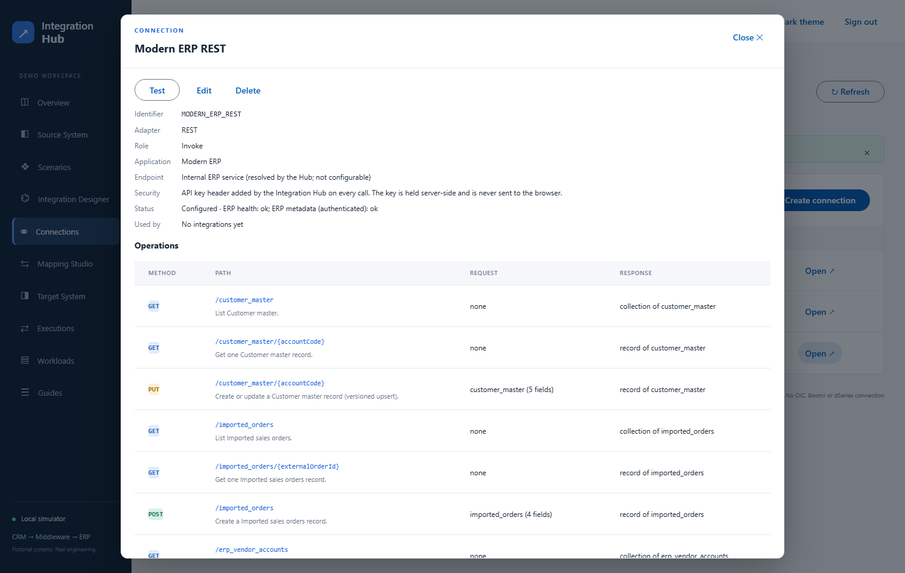
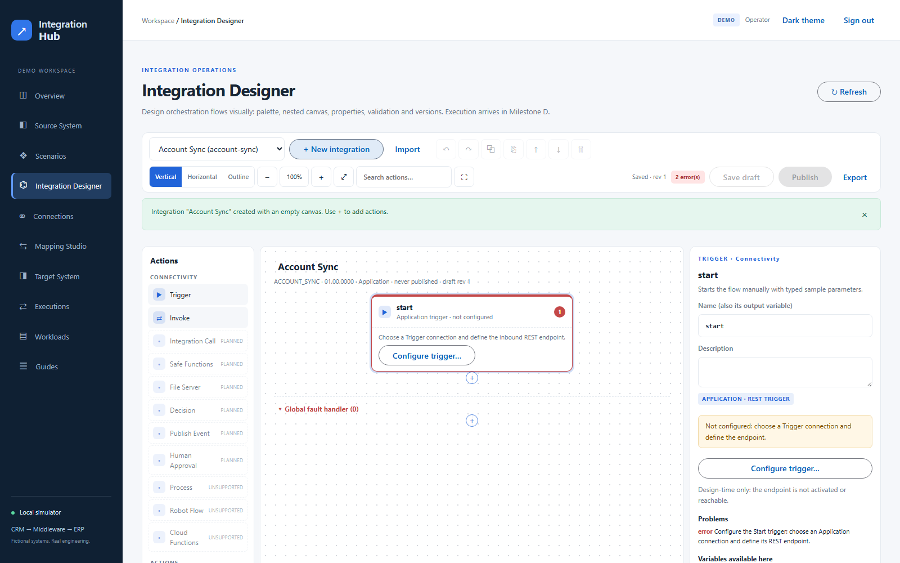
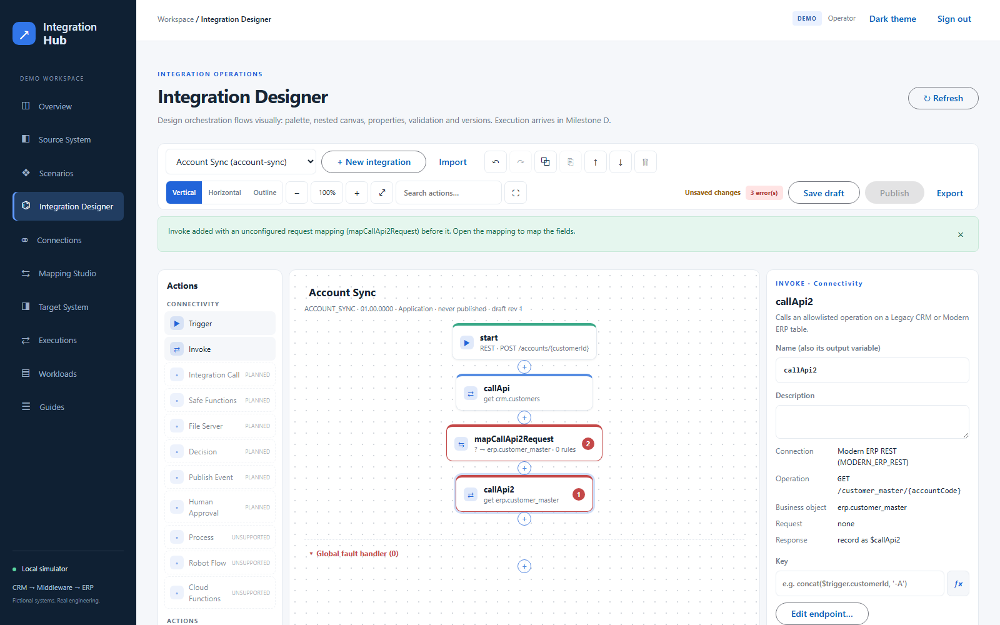
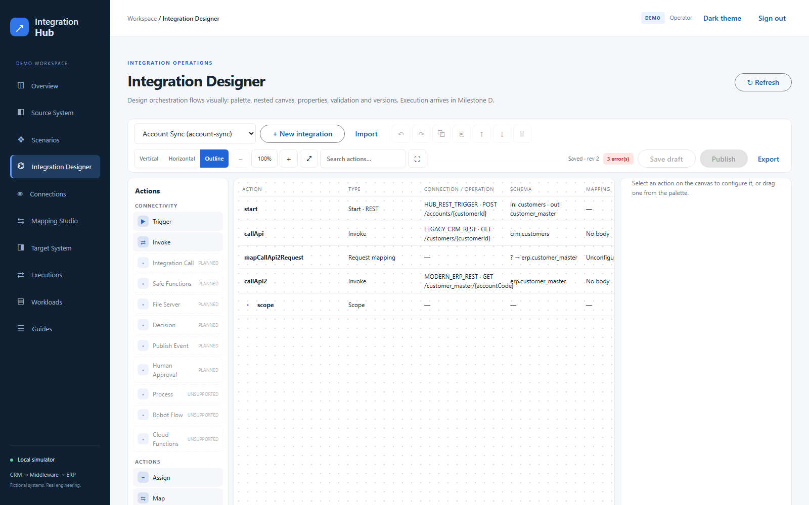
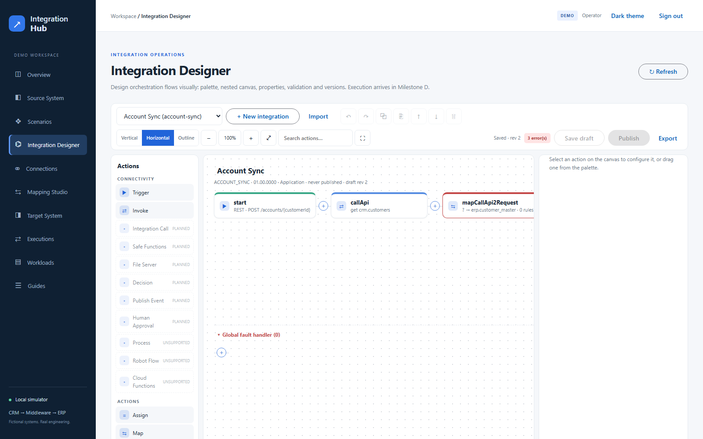

# Integration Workbench refinement (Milestone C.1)

Milestone C.1 makes authoring feel familiar to integration developers used to orchestration tools such as Oracle Integration 3. It keeps this project's own branding, components and code, and stays local-only. **Nothing executes yet**: running flows is Milestone D.

## Concepts researched and how they are adapted

| Concept in Oracle Integration 3 documentation | Here (original implementation) |
|---|---|
| Integration styles **Application** (an adapter trigger starts it) and **Schedule** (the trigger is a schedule) ([styles](https://docs.oracle.com/en/cloud/paas/application-integration/integrations-user/understand-integration-styles.html)) | New Integration wizard: **Application**, **Scheduled**, plus our own **Manual practice** mode |
| Identifier generated from the name in upper case; version `xx.xx.xxxx`, default `01.00.0000` ([create](https://docs.oracle.com/en/cloud/paas/application-integration/integrations-user/create-integrations.html)) | Same conventions: `CUSTOMER_SYNC`, `01.00.0000`, plus description and tags |
| Connections created separately with name, identifier, adapter and a role (Trigger, Invoke, or both, limited by the adapter), tested, then saved and reused ([connections](https://docs.oracle.com/en/cloud/paas/application-integration/database-adapter/create-connection.html)) | Connections workspace with a 9-step wizard. REST only, roles limited per application, safe tests, reused by any integration |
| REST endpoint wizard: endpoint name, relative resource URI, HTTP method; no request payload for GET/DELETE; pages appear by selection; query/template parameters configured before mapping ([REST invoke](https://docs.oracle.com/en/cloud/paas/application-integration/rest-adapter/add-rest-adapter-invoke-connection.html)) | Invoke and trigger endpoint wizards. Only operations the internal API really supports; GET never has a body; path parameters come from the path |
| Maps added when a trigger or invoke is configured, initially unconfigured, deletable; ad-hoc maps allowed ([triggers and invokes](https://docs.oracle.com/en/cloud/paas/application-integration/integrations-user/define-inbound-triggers-outbound-invokes.html)) | Mapping points: an unconfigured **request mapping** is placed before an Invoke whose operation sends a body. Response, trigger-response and file-structure mappings are added on request. Explicit Map actions remain |
| Canvas layouts **Vertical**, **Horizontal** and an **Outline** view with indented child actions and details ([canvas](https://docs.oracle.com/en/cloud/paas/application-integration/integrations-user/create-orchestrated-integration.html)) | Vertical, Horizontal and Outline layouts. The choice is stored per viewer, outside the flow |
| Schedules: simple frequencies or iCal, plus schedule parameters ([schedule](https://docs.oracle.com/en/cloud/paas/application-integration/integrations-user/define-integration-schedule.html)) | Design-time schedule: manual, daily, weekly or monthly, time, weekdays, day of month, IANA time zone, parameters. No iCal and no background jobs |

## Workflow

1. **Connections:** create `LEGACY_CRM_REST` and `MODERN_ERP_REST` (role Invoke) and a Hub REST trigger connection (role Trigger). Each wizard lists only approved internal applications. The Hub resolves addresses and keys, which never reach the browser.
   
2. **New integration:** choose Application, enter the name (the identifier is generated) and create. The canvas holds **only** the Start trigger and a `+`.
   
3. **Configure trigger…:** choose the Trigger connection, method, internal path (e.g. `/accounts/{customerId}`), parameters, and request and response schemas. Design-time only: the endpoint is not activated.
4. **`+` → Connections / Invokes:**
   - Choose a connection, an HTTP method the application supports, a business object, then review the request and response contracts and set the parameters.
   - Operations with a body get an unconfigured **request mapping** directly before the Invoke.
   
5. **Map** the request with the field mapper. Its target contract is locked to the endpoint.
6. **Review** in Vertical, Horizontal or Outline. Outline shows each action's type, connection and operation, schema, mapping status, validation and summary.
   
   
7. **Save the draft.** Incomplete drafts are allowed; publishing requires a valid graph.

## Rules worth knowing

- **Inline `+`** works in every lane: the main flow, Switch cases, loop bodies, Scope body and fault handler, Parallel branches and the global fault handler. Unavailable actions explain why:
  - *planned*;
  - *Re-throw Fault only inside a fault handler*;
  - *End actions only at the end of a path*.
- **Every Invoke goes through the endpoint wizard,** whether you drag it in, click it in the palette or pick it from `+`.
- **Changing an endpoint never deletes mapping rules.** If the new operation has no body, or targets another table, an impact dialog asks how to proceed: retarget the mapping or keep it. The mapping is then reported in Problems until reviewed, and publishing stays blocked until the flow is valid.
- **Existing designs keep working.**
  - Flows created before C.1 open as *Manual practice*.
  - Invokes without a connection still validate, with a warning.
  - The `eih-flow` export now carries style, identifier, version and tags; older documents import as Manual practice.
- **Blank means blank.** The former "Blank flow" template no longer adds a Return; a blank integration has no business actions.

## Connection Manager safety

- Applications are an allowlist: Legacy CRM, Modern ERP, Data Catalog metadata and the Integration Hub REST trigger. There is no URL field.
- Tests perform only `GET /health` and `GET /api/catalog/tables` (or a local check for the Hub trigger). Tests verify this by recording every upstream call.
- Deleting a connection, or changing its role, is refused while any draft or published version uses it.
- Operators manage connections; Viewers inspect metadata.

## Feature status (C.1)

| Feature | Status |
|---|---|
| New Integration wizard (type, name, identifier, version, description, tags) and blank canvas | Implemented |
| Starter templates as an optional choice (Manual practice) | Implemented |
| Connections workspace and 9-step wizard, CRUD, safe test, operation and schema discovery | Implemented |
| Invoke endpoint wizard (connection, method, business object, contracts, parameters, summary) | Implemented (design-time) |
| Application REST trigger wizard (method, internal path, parameters, request and response schemas) | Design only: no endpoint is activated |
| Scheduled trigger (manual, daily, weekly, monthly, time zone, parameters) | Design only: no background job |
| iCal schedule expressions | Deferred |
| Request, response, trigger-response and file-structure mapping points; impact detection | Implemented (design-time) |
| Inline `+` picker with categories and reasons; drag-and-drop kept | Implemented |
| Vertical, Horizontal, Outline layouts with per-viewer preference | Implemented |
| Data Catalog metadata invokes | Implemented (design-time) |
| SOAP, FTP, Database adapters; external URLs | Unsupported in this practice environment |
| Running integrations, activating endpoints, scheduling jobs | Deferred to Milestone D and later |
